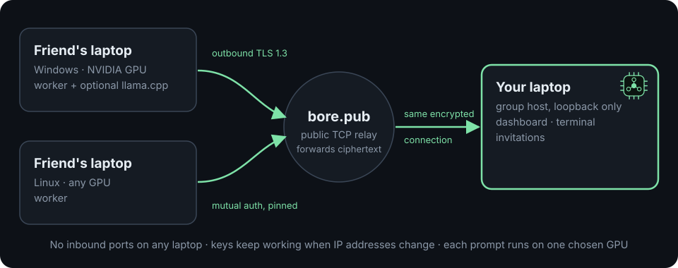

<p align="center">
  <picture>
    <source media="(prefers-color-scheme: dark)" srcset="docs/assets/logo-dark.svg">
    
  </picture>
</p>

<p align="center">
  <a href="https://github.com/Aruneshw/gpu_toolkit/actions/workflows/ci.yml"></a>
  <a href="https://github.com/Aruneshw/gpu_toolkit/releases/latest"></a>
  
  
  <a href="LICENSE"></a>
</p>

<p align="center">
  <b>Bring your friends' laptops and GPUs together in one dashboard, from anywhere.</b><br>
  One host, any number of friends, no port forwarding, no IPv6 required: through a public relay, or over your own Tailscale / WireGuard mesh.
</p>

---

## What it does

- **One dashboard for every GPU.** Each friend's laptop joins your group and
  shows up live: GPU model, VRAM used/free, utilisation, RAM, models and
  backend state, with totals across all laptops.
- **Joining is one key.** You click *Generate invitation*; your friend pastes
  the key into `win.bat` or `linux.sh`. Their computer creates its own key pair
  automatically. Keys are single use and expire.
- **Works from any network.** By default the host goes through the public relay
  **bore.pub**, so it does not matter that phone hotspots rotate IPv6 every few
  minutes, that a campus is behind CGNAT, or that Wi-Fi isolates clients.
- **Or over your own mesh VPN.** `host --mesh auto` (menu: *Host on a VPN*)
  listens on this computer's Tailscale or WireGuard address, so every computer
  on the same VPN connects directly with no relay in between.
- **Pool every GPU into one model.** Click *Start pool*: the host runs one
  `llama.cpp` server and spreads the model's layers over its own GPU and every
  friend's GPU (llama.cpp RPC). Friends lend their GPU automatically when they
  join; the pool reloads by itself when a laptop joins or leaves.
- **Run AI on any member.** Or send a prompt to one chosen laptop's own
  `llama.cpp` backend and stream the answer back into the dashboard.
- **Terminal on any laptop.** A real shell in the dashboard (colours, Ctrl-C,
  tab completion, `vim`, `htop`) on this computer, and on any friend's laptop
  whose owner allowed it when joining: an SSH-like session with no SSH server,
  port or key to set up.
- **Secure by construction.** TLS 1.3 mutual authentication with a pinned host
  certificate runs end to end, even through the relay. One Go binary using only
  the standard library: no runtime downloads, no services, no admin rights.

## Quick start (2 minutes)

Download the package for your system from
[**Releases**](https://github.com/Aruneshw/gpu_toolkit/releases/latest) and
extract it (`meshcompute-windows-amd64.zip` or `meshcompute-linux-amd64.tar.gz`).

**You (the host):**

| Linux | Windows |
| --- | --- |
| `./linux.sh` and choose **1** | double-click `win.bat` and choose **1** |

The dashboard opens in your browser and a key is printed (and copied to the
clipboard on Windows). Keep the window open and send the key privately.

**Your friend:**

| Windows | Linux |
| --- | --- |
| double-click `win.bat`, choose **2**, paste the key | `./linux.sh join <KEY>` |

Their laptop appears on your dashboard within seconds. Next time they only need
option **3 (Reconnect)**; the key keeps working across restarts and IP changes.

All menu options:

| | Linux | Windows |
| --- | --- | --- |
| Start the menu | `./linux.sh` | double-click `win.bat` |
| 1. Generate a key: host a group, open the dashboard | `./linux.sh host` | option 1 |
| 2. Join with a friend's key | `./linux.sh join <KEY>` | option 2 (or `.\join.cmd <KEY>`) |
| 3. Reconnect after closing the window | `./linux.sh reconnect` | option 3 |
| 4. Another key for your running group | `./linux.sh invite` | option 4 |
| 5. Install llama.cpp (lend this GPU, or pool GPUs as host) | `./linux.sh gpu` | option 5 |
| 6. Host on your Tailscale / WireGuard address | `./linux.sh mesh` | option 6 (`win.bat mesh`) |

The launchers install or update MeshCompute when needed (the bundled binary, or
the latest release with its SHA-256 checked). Pasting the whole command a friend
sent also works: the key is always the last word. Run from a source checkout,
`linux.sh` rebuilds the binary first.

## How it works

<p align="center"></p>

1. `host` creates a private certificate authority for your group, listens on
   loopback and registers a public port on the relay (saved and reused on
   every restart).
2. An invitation carries that address, the CA and the exact host-certificate
   fingerprint plus a single-use token.
3. `join` makes a key pair on the friend's computer, enrolls over pinned TLS
   and then keeps outbound connections open. The host sends status and
   inference requests down those connections; workers never accept inbound
   traffic and cannot reach each other.
4. The relay only copies encrypted bytes. Use `host --mesh auto` to host on a
   Tailscale / WireGuard address, or `host --direct` (`MESHCOMPUTE_RELAY=none`)
   to host on your own IP instead. See
   [Creator-hosted groups](docs/host-first-design.md#connectivity).
5. A terminal or a pooled model is a long-lived stream down the same outbound
   connection: the host never dials a worker, and nothing on a worker listens
   beyond loopback.

## Pool every GPU into one model

1. **Every computer** installs the same llama.cpp release once: `./linux.sh gpu`
   or `win.bat` option 5. (The RPC protocol is version-checked; the scripts
   pin one release.)
2. **Friends** join or reconnect as usual. Their laptop starts llama.cpp's RPC
   server on loopback and reports *GPU shared* on your dashboard.
3. **You** register a model once (`meshcompute model add NAME /path/model.gguf`,
   or let `./linux.sh gpu` download a small one) and click **Start pool** (or
   `meshcompute pool start NAME`, or `host --pool NAME`).
4. Choose node **local** in *Run inference*: the model now runs across your GPU
   and every shared GPU. The choice is remembered, and the pool reloads on its
   own when a laptop joins or leaves.

The model file is only needed on the host; its weights are sent to each worker
through the encrypted connection (cached there afterwards). That first load is
as fast as your link: a direct mesh VPN or LAN is much faster than the public
relay.

### Pool controls

- **Model library:** type a folder (for example your external HDD) under
  *Models & pools*, or run `meshcompute model scan DIR`; every `.gguf` is listed
  with its size and registered with one click.
- **Several pools at once:** each pool has a name, a model and its own workers
  (a worker lends its GPU to one pool). Two pools of the same model are
  replicas: requests take turns between them, or name one with
  `run --pool NAME` (dashboard: the *Pool* picker under *Run inference*).
- **Layer split:** automatic by free memory, or weights per computer
  (`--split local=1,WORKER=3`). The pool card shows how much of the model,
  KV cache and compute buffers landed on each computer, read from
  llama-server's own load log. If the host has no GPU llama.cpp can use, its
  share is ignored and the card says so.
- **KV cache and slots:** cache type (`--kv q8_0`, or `--kv-k`/`--kv-v`), keep
  the cache in host RAM (`--kv-on-host`), flash attention (`--flash on`),
  context size, and request slots (`--slots N`; each slot holds
  context ÷ slots tokens). A request that finds every slot busy, or asks for
  more context than a slot holds, is refused at once with that reason; it is
  never queued or sent elsewhere.

```sh
meshcompute --home ~/.meshcompute-group pool start qwen --name fast --slots 2 \
    --workers 0fa7,2b20 --split local=1,0fa7=1,2b20=2 --kv q8_0 --flash on
meshcompute --home ~/.meshcompute-group pool start qwen --name spare --workers 2f5c --kv-on-host
meshcompute --home ~/.meshcompute-group run qwen --pool spare --prompt "Hello"
meshcompute --home ~/.meshcompute-group pool stop spare     # or: pool remove spare
```

Worker IDs can be shortened to any unique prefix.

## Terminal on a friend's laptop

The friend decides. When joining from the menu they are asked *Allow a remote
terminal on this computer? [y/N]* (command line: `join --allow-terminal`, or
later `meshcompute config set allow_terminal true` and reconnect). Their window
prints a line every time you open a session. On your dashboard, pick the laptop
in the terminal's computer list. Linux workers give you their login shell;
Windows 10 (1809) or newer gives PowerShell.

## Live fleet view and one terminal per worker

The host dashboard opens with **Fleet · live**: one card per computer,
refreshed every 2 seconds, showing GPU utilization, VRAM, GPU temperature and
power, CPU and RAM, the measured round trip from the host to that laptop
through its encrypted link, whether it lends its GPU or is in the pool, and
what you are doing there (tasks running, waiting, finished; terminals open).
Each card draws the last three minutes of GPU, VRAM and link history. Its
*Terminal* and *Send task* buttons jump to that laptop.

**Terminal grid** gives every worker that allowed a terminal its own pane
(5 workers, 5 terminals). Typing in a pane runs on that laptop only; tick
*type into all ticked panes* to send the same keys to several at once.
*Connect all workers* opens them all and the dashboard reconnects them after a
page reload, replaying recent output. All panes share one connection, so the
browser's connection limit is never reached. A worker's own dashboard shows
its own live card.

## Send tasks to workers (with their approval)

On the host dashboard, the **Tasks** panel sends one command to every worker
you tick (shell: auto = bash on Linux, PowerShell on Windows; or bash, sh,
PowerShell, pwsh, cmd). Each worker gets its own copy; you see its state
(waiting for approval, running, succeeded, failed, denied, cancelled) and its
output live, and can cancel it. A task keeps running if the connection drops;
the host reconnects and resumes the output where it stopped.

Every worker now has its **own dashboard** (`join` and `start` open it, at
http://127.0.0.1:8082 by default; `--no-open` skips the browser). It shows the
link to the host, every task with its exact command, and the owner's switches:

- **Tasks from the host:** *ask me each time* (default; Approve, Always allow,
  Deny), *run automatically*, or *refuse all*. Command line:
  `join --tasks ask|auto|off`, or `meshcompute config set task_approval ...`.
- **Allow the host to open a terminal here**, and a button that closes the
  host's open terminals.
- **Lend my GPU to the pooled model** (applies on reconnect).

A task runs as the worker's user account, like a terminal. Unapproved tasks
expire after 10 minutes. Plans for the next steps (layer and KV-cache
controls, several pools, faster links, multi-hop) are in
[docs/plan-workers.md](docs/plan-workers.md).

## Honest scope

- **Pooling is llama.cpp RPC, with its limits.** The pool splits one model's
  layers across machines. Every token crosses the network between layers, so
  speed depends on the link (LAN or a direct mesh VPN is good; a relay on a
  slow uplink is slow), and a laptop leaving mid-answer fails that answer and
  reloads the model. Upstream still calls its RPC backend experimental. All
  computers need the same llama.cpp release.
- **Without the pool**, totals are only a sum: a prompt runs entirely on the
  one laptop you select, using that laptop's own `llama-server` and model.
- **A remote terminal is full shell access** as that laptop's user. It is off
  until the laptop's owner turns it on.
- **Tested:** unit and race tests; end-to-end tests of the pool (real
  processes, sockets and TLS tunnels, with stand-ins for the two llama.cpp
  programs), of the remote terminal, and of worker consent; a real WireGuard
  tunnel between two network namespaces (host on the VPN address, join,
  remote terminal); a live pool with the real llama.cpp b12182 CPU build (a
  worker's `ggml-rpc-server` held part of the model and answered through the
  tunnel); two named pools of one model at once over three workers with
  their own split, KV cache and slot settings (`scripts/pool-test.sh`) and the
  dashboard with five workers (`scripts/ui-test.sh`), both with real
  llama.cpp; Linux and real-Windows CI through `linux.sh`/`win.bat`;
  live joins over IPv6 and through bore.pub. **Not yet established:** the pool
  on two physical GPUs, a running Tailscale client, and the Windows remote
  terminal on a physical PC. Details in
  [docs/validation.md](docs/validation.md).

## Requirements

- Linux amd64/arm64 or Windows 10/11 amd64. macOS and AMD/Intel GPUs are not
  validated. NVIDIA GPUs are detected through `nvidia-smi`.
- Outbound internet access on every computer (any network; IPv4 is enough),
  or all computers on one Tailscale / WireGuard network.
- For the pool: the same llama.cpp release on every computer (`./linux.sh gpu`,
  `win.bat` option 5) and one licensed GGUF model on the host. For
  single-laptop inference: `llama-server` and a model on that laptop. Nothing
  is downloaded silently.
- To build from source: Go 1.24 or newer (standard library only, builds
  offline). The release packages need no Go.

## Install

### Manual commands (without the launchers)

The launchers above only wrap these commands:

```sh
# host: relay by default; prints a key and the dashboard link
meshcompute --home ~/.meshcompute-group host --relay bore.pub --ttl 1h --open
meshcompute --home ~/.meshcompute-group host --mesh auto --open   # Tailscale / WireGuard instead
meshcompute --home ~/.meshcompute-group pair --ttl 1h      # another key
meshcompute mesh                                           # which VPN addresses were found
meshcompute --home ~/.meshcompute-group pool start NAME    # one model across all shared GPUs

# friend: enroll with the key and stay connected (reconnects automatically)
meshcompute join <KEY>                                     # add --allow-terminal to permit a shell
meshcompute start                                          # later: reconnect
```

`--mesh` takes `auto`, `tailscale`, `wireguard`, an interface name (`wg0`) or
the VPN IP itself (needed for WireGuard on Windows, whose adapter has no fixed
name). The group then stays on that address across restarts and refuses to
move silently if the VPN is down. Without a relay or mesh, `host --direct --auto` picks this computer's global IPv6 (or a
private IPv4 that needs a router port forward). Each creator hosts an
independent group. See [Creator-hosted groups](docs/host-first-design.md) for
addresses, reconnection, inference setup and network requirements.

### Source and manual installation

Linux (user-scoped, offline build):

```sh
sh installers/install.sh
# binary: ~/.local/bin/meshcompute
```

Windows (non-administrator PowerShell, no Go required):

```powershell
.\installers\install-prebuilt.ps1 -BinaryPath .\meshcompute-windows-amd64.exe -Sha256 <verified-sha256>
# binary: %LOCALAPPDATA%\meshcompute\bin\meshcompute.exe
```

The prebuilt installer verifies SHA-256, stages the file, runs the one-time
`install` step, and records the hash in `install.json`; uninstall verifies that
marker and also needs no Go. See [docs/windows.md](docs/windows.md) for the
release download, firewall, CUDA, enrollment, and rollback details.

To build on Windows with Go instead:

```powershell
.\installers\install.ps1
```

All installers are user-scoped, build or stage the binary, and refuse to replace
an unrelated or symlinked file. They do not install a service, driver, model,
firewall rule, or PATH entry. Uninstall removes only the binary and preserves
configuration/state.

Or build directly:

```sh
make build        # bin/meshcompute
make verify       # formatting, vet, tests, cross-builds, offline build
```

## Advanced: private LAN/VPN cluster

The original direct-peer mode for machines on one private network or VPN.
Coordinator (machine A, e.g. a private VPN IP `100.64.0.10`):

```sh
meshcompute install
meshcompute config set listen 100.64.0.10:7443
meshcompute cluster create
meshcompute start                 # foreground HTTPS agent
```

In another terminal, issue a short-lived, single-use invitation:

```sh
meshcompute pair --ttl 5m
```

Deliver the invitation out of band through an authenticated, confidential
channel. Do not paste it into logs or shell history.

Worker (machine B, e.g. `100.64.0.11`):

```sh
meshcompute install
meshcompute config set listen 100.64.0.11:7443
meshcompute join --stdin          # paste invitation, then Ctrl-D
meshcompute start
```

Back on the coordinator, register the worker's exact endpoint and inspect both
nodes over mutual TLS:

```sh
meshcompute peer add worker1 https://100.64.0.11:7443
meshcompute status
meshcompute monitor --interval 5s
```

`status` and `run --node local` also work on a node against its own loopback
agent. A node accepts only its own leaf certificate or the cluster peer it is
configured to trust; worker-to-worker access is rejected.

Start the localhost dashboard on any enrolled node:

```sh
meshcompute ui
# MeshCompute dashboard: http://127.0.0.1:8081/?token=<one-time printed token>
```

Open the printed URL. The token is exchanged for an HttpOnly, SameSite=Strict
cookie and removed from the address bar. The page shows every configured node's
GPU, VRAM, RAM, models and backend health, and can stream a prompt to one
selected node. See [Honest scope](#honest-scope).

Revoke a worker locally on the coordinator:

```sh
meshcompute revoke worker-<id>
```

Revocation is reloaded on every authenticated request, including new handshakes
on already-open clients. In-flight streams are not cancelled.

## Local model and inference

Build `llama-server` from the pinned upstream commit and register a licensed GGUF
locally. Downloads are never automatic. Full build commands, CUDA notes, and the
verified HTTP contract are in [docs/backend.md](docs/backend.md).

```sh
meshcompute model add my-model /absolute/path/model.gguf
meshcompute model list
meshcompute backend list
meshcompute backend serve my-model --context 2048 --gpu-layers 0 \
  --kv-bytes-per-token VERIFIED_VALUE
```

In a second terminal, on the same node:

```sh
meshcompute run my-model --prompt "Hello" --max-tokens 128 --context 2048
# or target an enrolled worker from the coordinator:
meshcompute run my-model --node worker1 --prompt "Hello"
# on a group host with several pools: pick one
meshcompute run my-model --pool fast --prompt "Hello"
```

`run --node auto` considers local first, then configured peers, and requires the
selected node to advertise exactly the requested model and enough context. It
never falls back silently after generation starts. `simulate` prints clearly
labeled synthetic scheduling examples and performs no inference.

## Dashboard

`host` starts it automatically; on any enrolled node `meshcompute ui --open`
starts one too. It listens on `127.0.0.1` only and opens with a one-time token.

- **Totals and inventory:** nodes, GPUs, VRAM total/free, RAM, models, and a
  per-GPU table (used, free, utilisation, driver) for every laptop.
- **Invite a friend:** choose an expiry (30 minutes to 24 hours) and click
  *Generate invitation*: copy-ready commands for Windows and Linux plus a live
  countdown.
- **Pooled GPUs:** pick a registered model, *Start pool*, and watch which
  laptops lend a GPU, the load state and llama-server's last log lines.
- **Run inference:** pick a ready node and model (node *local* is the pool
  when it is on; with several pools, the *Pool* picker chooses one), stream
  tokens back, stop at any time. Failures are reported
  and never retried elsewhere.
- **Terminal:** a real shell (xterm.js on a pseudo-terminal) that survives
  page reloads. The computer list offers this computer and every laptop whose
  owner allowed a terminal.

## Configuration and commands

State lives under the user config directory (`MESHCOMPUTE_HOME` overrides it):

- `config.json` — listen, advertise, backend URL, peers (no secrets)
- `identity.json` — private CA/leaf material owned by the local user (0600)
- `models/` — local model registry entries (paths and SHA-256)

`meshcompute help` lists every command. Useful diagnostics:

```sh
meshcompute doctor              # redacted, shareable output
meshcompute network probe NAME  # authenticated RTT/throughput to one worker
```

## Security boundaries

Read [docs/security.md](docs/security.md) before deployment. Key points:

- The coordinator keeps the CA private key; workers never receive it.
- Invitations are bearer credentials with 256-bit tokens, hashed at rest,
  single-use, and expire (maximum 24 hours; prefer minutes).
- An invitation also carries the CA and exact coordinator certificate
  fingerprint. Out-of-band authenticity is essential: a substituted invitation
  changes the trust root.
- TLS 1.3 mutual authentication, pinned coordinator leaf, fixed private/loopback
  IP endpoints, proxies and redirects disabled.
- Through the public relay, traffic stays TLS 1.3 with mutual authentication
  and the pinned host certificate; the relay sees only ciphertext and
  connection metadata. Use `--relay` with your own bore server, or `--direct`,
  if that metadata exposure is unacceptable.
- The local filesystem is the administrative authority. There are no remote
  administrative routes and no HTTP enrollment fallback.
- The dashboard binds `127.0.0.1` only, requires a 256-bit token, rejects
  non-loopback Host headers and cross-origin POSTs, and sets a strict CSP. It
  reads telemetry, requests inference, issues invitations and controls the
  pool (group host only), and opens a terminal on the local computer and on
  workers that allowed it. Treat the dashboard URL/token like a password: it
  grants those shells.
- A worker serves a terminal only if its owner set `allow_terminal`, only to
  the pinned group host, and only down its own outbound connection. Workers
  can never open a terminal on the host or on each other.
- llama.cpp's RPC server has no authentication of its own, so MeshCompute
  binds it to loopback and reaches it solely through the mutually
  authenticated tunnel; `share_gpu off` disables it on a worker.
- No certificate rotation, CRL/OCSP, HA consensus, rate limiting, or audit log
  shipping is built in. Those remain deployment responsibilities.
- Treat GGUF files and backend binaries as untrusted inputs. Never expose
  `llama.cpp` RPC to an open network yourself; a worker that lends its GPU
  trusts the group host with that RPC server's parsers.

On Windows, privacy depends on the inherited ACLs of the user profile; Unix mode
bits and directory `fsync` are not portable and are substituted accordingly.

## Documentation

- [Architecture decisions](docs/architecture.md)
- [Security model](docs/security.md)
- [llama.cpp backend contract](docs/backend.md)
- [Windows deployment](docs/windows.md)
- [Creator-hosted groups](docs/host-first-design.md)
- [Project overview and rebuild summary](docs/project-report.md)
- [Complete report: architecture, history, failures, architecture v2, all commands](docs/full-project-report.md)
- [Implementation plan](docs/plan.md)
- [Validation evidence](docs/validation.md)

## License

Apache-2.0. See [LICENSE](LICENSE).
